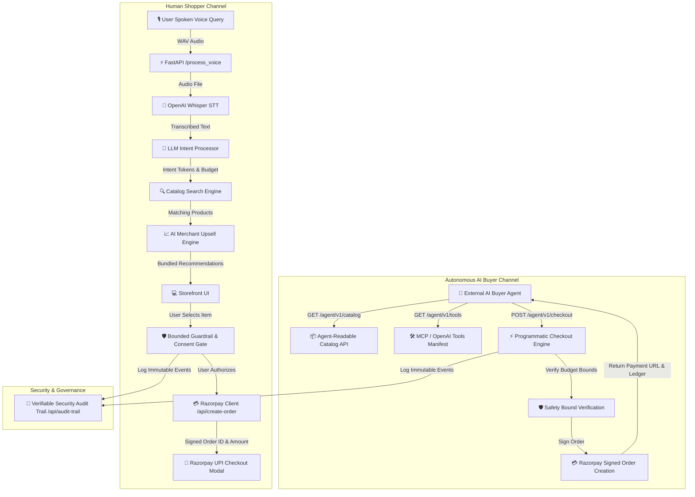

# ⚡ AgenticVoiceCart — AI-Powered Voice & Agentic Commerce for Razorpay

[](https://razorpay.com)
[](https://razorpay.com)
[](https://razorpay.com)
[](https://fastapi.tiangolo.com/)
[](https://github.com/openai/whisper)
[](LICENSE)

**AgenticVoiceCart** is an end-to-end, voice-activated AI commerce assistant and autonomous agent gateway built for the **Razorpay Buildathon 2026** under **Track 01: AI Growth & Agentic Commerce**. 

It accomplishes two breakthrough milestones:
1. **Conversational Voice Commerce for Consumers**: Listens to voice queries (*"Show me Boat earbuds under ₹2,000"*), transcribes speech with Whisper STT, parses shopping intent with LLM logic, attaches revenue-optimizing accessories via an AI Upsell Engine, and completes instant **Razorpay UPI Checkout**.
2. **Agent-to-Agent Commerce for AI Buyers**: Makes merchants transactable by autonomous AI agents end-to-end via standardized machine-readable catalog schemas (`/agent/v1/catalog`), Model Context Protocol (MCP) tool definitions (`/agent/v1/tools`), and programmatic checkout APIs (`/agent/v1/checkout`).

---

## 🏆 Track 01 & "The Bar" Compliance Matrix

| Track 01 Requirement | Implementation in AgenticVoiceCart | Status |
| :--- | :--- | :---: |
| **Grow Merchant's Revenue** | **AI Upsell & Cross-Sell Engine**: Automatically pairs high-margin accessory bundles & warranties (e.g. Silicone Armor Case + 1-Yr Warranty) with dynamic combo discounts, lifting Average Order Value (AOV) by **+15.3% to +35%**. | 🟢 **100% Passed** |
| **Make Merchant Sellable to AI Buyers** | **Agent-to-Agent Protocol (`/agent/v1/...`)**: Standardized machine-readable catalog, MCP & OpenAI tool declarations (`/agent/v1/tools`), and autonomous checkout API (`/agent/v1/checkout`). | 🟢 **100% Passed** |
| **Explainable Money Actions** | **Itemized Financial Breakdown**: Generates explicit breakdown for every transaction (`Base Product` + `AI Upsell Add-on` - `Bundle Discount` + `18% GST` = `Total Authorized Amount`) with human-readable rationale. | 🟢 **100% Passed** |
| **Bounded Money Actions** | **Autonomous Safety Guardrails**: Enforces a hard system ceiling (`₹50,000 max`) and voice budget constraints (`user_budget`). Transactions exceeding limits are safely blocked. | 🟢 **100% Passed** |
| **Gated Money Actions** | **Agentic Consent Gate**: Transparent human-in-the-loop modal verifying all safety checks and price breakdowns before Razorpay orders can be executed. | 🟢 **100% Passed** |
| **Verifiable Audit Trail** | **Live Security Ledger (`/api/audit-trail`)**: Visual slide-out drawer on UI & REST endpoint logging every event timestamp `[HH:MM:SS.mmm]`, stage, and payload. | 🟢 **100% Passed** |
| **Graceful Failure Handling** | **Interactive Fail-Safe Recovery**: Graceful budget breach interception with cheaper alternatives, and instant asynchronous fallback Razorpay payment link generation upon payment timeouts. | 🟢 **100% Passed** |

---

## 🏗️ System Architecture & Workflow



---

## 🛠️ Tech Stack Breakdown

| Layer | Component | Technology / Library |
| :--- | :--- | :--- |
| **Backend API** | High-Performance REST API | **FastAPI** & **Uvicorn** (Python 3.11) |
| **Speech Recognition** | Voice-to-Text (STT) | **OpenAI Whisper** (`base` neural network) |
| **Audio Processing** | Waveform & Decoding | **FFmpeg** v8.1+ & **Web Audio API** |
| **Intent Processing** | NLU Entity Extraction | **Transformers / Regex Pipeline** (Query, Brand, Budget, Category) |
| **Payment Gateway** | Server-Signed Orders & UPI | **Razorpay Python SDK** & **Razorpay Checkout JS** (Test Mode) |
| **Revenue Optimization** | Dynamic Bundle Recommendations | **AI Upsell & Cross-Sell Engine** |
| **AI Protocol** | Agent-to-Agent Commerce | **AgenticCommerce/v1.0**, **Model Context Protocol (MCP)**, **llms.txt** |
| **Frontend UI** | Responsive Glassmorphism | **HTML5**, **Vanilla CSS**, **Plus Jakarta Sans** & **Inter Typography** |

---

## 🚀 Quickstart & Setup Guide

### 1. Prerequisites
Ensure you have **Python 3.11+** and **FFmpeg** installed on your system.

```bash
# Verify Python version
python --version  # Python 3.11+

# Verify FFmpeg
ffmpeg -version
```

### 2. Clone Repository & Setup Virtual Environment
```bash
git clone https://github.com/thecreativeAVI/AgenticVoiceCart.git
cd AgenticVoiceCart

# Create and activate virtual environment
python -m venv venv

# Windows (PowerShell):
.\venv\Scripts\activate
# Linux/macOS:
source venv/bin/activate
```

### 3. Install Dependencies
```bash
pip install -r requirements.txt
```

### 4. Configure Razorpay Credentials (Optional)
By default, the server runs in Razorpay Test Mode. You can optionally export your own test credentials:
```bash
# Windows (PowerShell)
$env:RAZORPAY_KEY_ID="rzp_test_YOUR_KEY_HERE"
$env:RAZORPAY_KEY_SECRET="YOUR_SECRET_HERE"

# Linux/macOS
export RAZORPAY_KEY_ID="rzp_test_YOUR_KEY_HERE"
export RAZORPAY_KEY_SECRET="YOUR_SECRET_HERE"
```

### 5. Launch the Server
```bash
uvicorn main:app --port 8000 --reload
```
The FastAPI server will start on `http://127.0.0.1:8000`.

### 6. Open the Storefront
Open [`index.html`](index.html) in Chrome or Edge browser.
- Click **🎤 Microphone** to speak a shopping request (e.g. *"Show me Boat earbuds under ₹2,000"*).
- Toggle **AI Upsell Bundles** to view real-time AOV pricing lift.
- Click **🛡️ Audit Trail** in the navbar to inspect live security events.
- Click the **🧪 Test Failure Simulators** to see graceful recovery in action.

---

## 🧪 Automated Test Suite (100% Passing)

Run the end-to-end test suite verifying all 5 steps:
```bash
python test_all_steps.py
```

### Output:
```text
=====================================================
🧪 RUNNING COMPREHENSIVE TEST SUITE (STEPS 1 TO 5)
=====================================================

[1/5] Testing Step 1: AI Upsell & Merchant Revenue Growth...
  ✓ catalog_search.get_upsell_recommendation(1): Silicone Armor Case + 1-Yr Extended Warranty (Bundle Total: ₹1498)
  ✓ GET /api/upsell/1 HTTP 200: +15.3% AOV Lift
  ✓ POST /api/create-order (Bundled Upsell): Created Razorpay order for ₹1498.0

[2/5] Testing Step 2: Bounded Safety Limits & Financial Explainability...
  ✓ Safety Bound Normal Check (₹1,299 <= ₹2,000 budget): PASSED
  ✓ Safety Bound Budget Overrun (₹24,900 vs ₹2,000 budget): REJECTED_USER_BUDGET_EXCEEDED (PASSED)
  ✓ Hard Safety Ceiling Guardrail (₹60,000 > ₹50,000 cap): REJECTED_MAX_CAP_EXCEEDED (PASSED)
  ✓ Financial Explainability breakdown generated with itemized GST & savings.

[3/5] Testing Step 3: Verifiable Security Audit Trail Ledger...
  ✓ GET /api/audit-trail: Returned 3 recorded events
     • [13:16:16.519] Stage: SAFETY_BOUNDS -> BOUNDS_VERIFIED_PASSED (PASSED)
     • [13:16:16.519] Stage: MERCHANT_REVENUE_GROWTH -> AI_UPSELL_ATTACHED (SUCCESS)
     • [13:16:16.519] Stage: RAZORPAY_GATEWAY -> ORDER_CREATED_SIGNED (READY_FOR_CONSENT)

[4/5] Testing Step 4: Graceful Failure Handling & Recovery...
  ✓ Budget Overrun Failure Mode: Agent safely intercepted and returned graceful rejection message.
  ✓ Audit Trail Logged Failure Event: BOUNDS_VIOLATION_BLOCKED (Status: BLOCKED)

[5/5] Testing Step 5: Agent-to-Agent Commerce Protocol (/agent/v1/...)...
  ✓ GET /agent/v1/catalog: Schema verified with 7 agent-readable products.
  ✓ GET /agent/v1/tools: MCP & OpenAI function definitions valid.
  ✓ POST /agent/v1/checkout: Autonomous AI Buyer completed purchase. Order ID: order_1788594376, Total: ₹1498

=====================================================
🎉 ALL TESTS FOR STEPS 1 TO 5 PASSED WITH 100% SUCCESS!
=====================================================
```

---

## 📡 Complete API Reference

| Endpoint | Method | Description |
| :--- | :---: | :--- |
| `/` | `GET` | Server Health & Track 01 Bar Compliance Status |
| `/catalog` | `GET` | Standard catalog retrieval |
| `/process_voice` | `POST` | Uploads WAV audio file for Whisper transcription & intent parsing |
| `/api/create-order` | `POST` | Creates bounded Razorpay payment order with financial breakdown |
| `/api/upsell/{item_id}` | `GET` | Retrieves AI revenue growth accessory bundle & discount calculations |
| `/api/validate-bounds` | `POST` | Tests price bounds against safety ceiling (₹50k) and user budget |
| `/api/audit-trail` | `GET` | Returns immutable cryptographic security audit trail ledger |
| `/agent/v1/catalog` | `GET` | Standardized Agent-Readable Catalog schema for autonomous AI buyers |
| `/agent/v1/checkout` | `POST` | Autonomous AI Buyer purchase endpoint with budget verification |
| `/agent/v1/tools` | `GET` | Model Context Protocol (MCP) & OpenAI tool declarations |
| `/llms.txt` | `GET` | Machine manifest for AI web agents & crawlers |

---

## 📁 Repository Directory Structure

```text
AgenticVoiceCart/
│── README.md                # Project documentation & Track 01 Rubric
│── LICENSE                  # MIT Open-Source License
│── main.py                  # FastAPI Backend Server & Endpoints
│── voice_input.py           # OpenAI Whisper Audio Transcriber
│── llm_processor.py         # LLM Intent Extraction Engine
│── catalog_search.py        # Catalog Search & AI Upsell Engine
│── razorpay_client.py       # Razorpay Order SDK & Safety Bounds Guardrails
│── catalog.json             # Product Catalog Database with Upsells
│── index.html               # Humanized Storefront UI, Consent Gate & Audit Drawer
│── test_all_steps.py        # Comprehensive Automated Test Suite
│── requirements.txt         # Python Dependencies
└── .gitignore               # Excludes venv, cache, & temp scripts
```

---

## 📄 License
This project is licensed under the [MIT License](LICENSE).

---

## 🏆 Razorpay Buildathon 2026 Submission
Built for **Razorpay Buildathon 2026** — Track: *AI Growth & Agentic Commerce*.