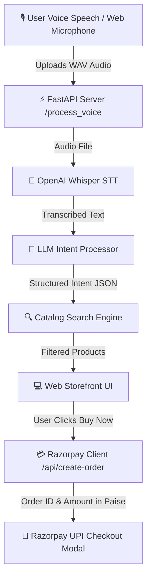

# ⚡ AgenticVoiceCart — AI-Powered Voice Commerce for Razorpay

[](https://razorpay.com)
[](https://razorpay.com)
[](https://fastapi.tiangolo.com/)
[](https://github.com/openai/whisper)
[](LICENSE)

**AgenticVoiceCart** is an end-to-end, voice-activated AI commerce assistant built for the **Razorpay Buildathon 2026** under the *AI Growth & Agentic Commerce* track. It enables users to search product catalogs naturally using spoken voice queries (e.g. *"Show me Sony noise cancelling headphones under ₹30,000"*), parses shopping intent with NLP/LLM logic, and completes instant **Razorpay UPI Checkout**.

---

## 🎯 Problem vs. Solution

| The Friction (Problem) | AgenticVoiceCart (Solution) |
| :--- | :--- |
| **High Friction Navigation**: E-commerce search requires typing, applying multiple price filters, and manual category navigation. | **Hands-Free Speech Interaction**: Users state their product criteria, budget limits, and brand preferences in a single 5-second voice utterance. |
| **Broken Voice Checkout**: Existing voice assistants hand off to complex checkout forms or external links. | **Native Razorpay UPI Integration**: Direct, seamless Razorpay Checkout SDK trigger pre-filled with order IDs generated server-side. |
| **Unreliable Intent Extraction**: Keyword search fails on conversational speech like *"under 2000 rupees"*. | **Sub-Second Intent NLU**: Extracts product queries, maximum prices in INR, brand names, and categories cleanly. |

---

## 🏗️ System Architecture & Workflow



### End-to-End Processing Steps:
1. **Audio Capture**: Browser records microphone input via HTML5 MediaRecorder API or native Windows MCI API.
2. **Speech Recognition**: OpenAI Whisper transcribes recorded speech into clean text.
3. **Intent Parsing**: `llm_processor.py` extracts structured parameters: `query`, `max_price`, `brand`, and `category`.
4. **Catalog Matching**: `catalog_search.py` queries `catalog.json` and filters products matching price constraints and keyword tokens.
5. **Razorpay Order Creation**: `razorpay_client.py` computes amount in paise (`price * 100`) and issues a server-side Razorpay order ID.
6. **Checkout Modal**: Web frontend launches Razorpay Checkout SDK for instant UPI test payment completion.

---

## 🛠️ Tech Stack Breakdown

| Layer | Component | Technology / Library |
| :--- | :--- | :--- |
| **Backend Framework** | REST API Server | **FastAPI** & **Uvicorn** (Python 3.11) |
| **Speech Recognition** | Voice-to-Text (STT) | **OpenAI Whisper** (`base` neural network) |
| **Audio Decoding** | Media Processing | **FFmpeg** v8.1+ |
| **NLU & Intent Extraction** | Entity Parsing | **HuggingFace Transformers / Regex NLU Pipeline** |
| **Payment Gateway** | Order Engine & UPI | **Razorpay Python SDK** & **Razorpay Checkout JS** |
| **Frontend Interface** | Modern Storefront | **HTML5**, **Vanilla CSS** (Plus Jakarta Sans & Inter), **Web Audio API** |

---

## 🚀 Quickstart & Setup Guide

### 1. Prerequisites
Ensure you have **Python 3.11+** and **FFmpeg** installed on your system PATH.

```bash
# Verify Python version
python --version  # Should be Python 3.11+

# Verify FFmpeg
ffmpeg -version
```

### 2. Clone the Repository & Virtual Environment Setup
```bash
git clone https://github.com/thecreativeAVI/AgenticVoiceCart.git
cd AgenticVoiceCart

# Create virtual environment
python -m venv venv

# Activate virtual environment
# Windows (PowerShell):
.\venv\Scripts\activate
# Linux/macOS:
source venv/bin/activate
```

### 3. Install Dependencies
```bash
pip install -r requirements.txt
```

### 4. Configure Razorpay Credentials (Optional)
By default, the server uses Razorpay Test Mode keys. You can optionally export your own test credentials:
```bash
# Windows (PowerShell)
$env:RAZORPAY_KEY_ID="rzp_test_YOUR_KEY_HERE"
$env:RAZORPAY_KEY_SECRET="YOUR_SECRET_HERE"

# Linux/macOS
export RAZORPAY_KEY_ID="rzp_test_YOUR_KEY_HERE"
export RAZORPAY_KEY_SECRET="YOUR_SECRET_HERE"
```

### 5. Launch the Application Server
```bash
uvicorn main:app --port 8000 --reload
```
The FastAPI backend server will be running live on `http://127.0.0.1:8000`.

### 6. Open the Web Storefront
Open [`index.html`](index.html) in Chrome or Edge browser, click the **🎤 Microphone Button**, and test voice search live!

---

## 📡 API Endpoints Documentation

### 1. Health Check
`GET /`
* **Response**:
  ```json
  {
    "status": "online",
    "app": "AgenticVoiceCart",
    "vision": "AI-Powered Voice Commerce for Razorpay"
  }
  ```

### 2. Voice Input Processing
`POST /process_voice`
* **Body**: `multipart/form-data` with `audio` WAV file.
* **Response**:
  ```json
  {
    "success": true,
    "text": "Show me wireless earbuds under 2000 rupees.",
    "intent": {
      "query": "wireless earbuds",
      "max_price": 2000,
      "brand": null,
      "category": "earbuds"
    },
    "results": [
      {
        "id": 1,
        "name": "Boat Airdopes 141 TWS Earbuds",
        "price": 1299,
        "brand": "Boat",
        "category": "earbuds"
      }
    ],
    "count": 1
  }
  ```

### 3. Razorpay Order Creation
`POST /api/create-order`
* **Body**: `{ "item_id": 2 }` or Query Param `?item_id=2`
* **Response**:
  ```json
  {
    "success": true,
    "order_id": "order_1788265796",
    "amount": 2999000,
    "currency": "INR",
    "razorpay_key_id": "rzp_test_YourTestKeyId"
  }
  ```

### 4. Fetch Full Catalog
`GET /catalog`
* **Response**: Array of product objects from `catalog.json`.

---

## 📁 Repository Directory Structure

```text
AgenticVoiceCart/
│── README.md                # Project documentation
│── LICENSE                  # MIT Open-Source License
│── main.py                  # FastAPI Backend Server & Endpoints
│── voice_input.py           # OpenAI Whisper Audio Transcriber
│── llm_processor.py         # LLM Intent Extraction Engine
│── catalog_search.py        # Catalog Search & Filter Module
│── razorpay_client.py       # Razorpay Order SDK Integration
│── catalog.json             # Product Catalog Database
│── index.html               # Humanized Storefront UI & Checkout Modal
│── requirements.txt         # Python Dependencies
└── .gitignore               # Excludes venv, audio logs, & temp scripts
```

---

## 📄 License
This project is licensed under the [MIT License](LICENSE).

---

## 🏆 Razorpay Buildathon Credits
Created for **Razorpay Buildathon 2026** — Track: *AI Growth & Agentic Commerce*.